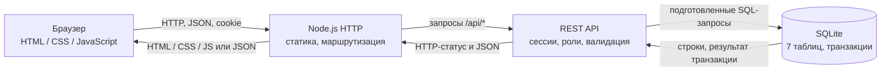
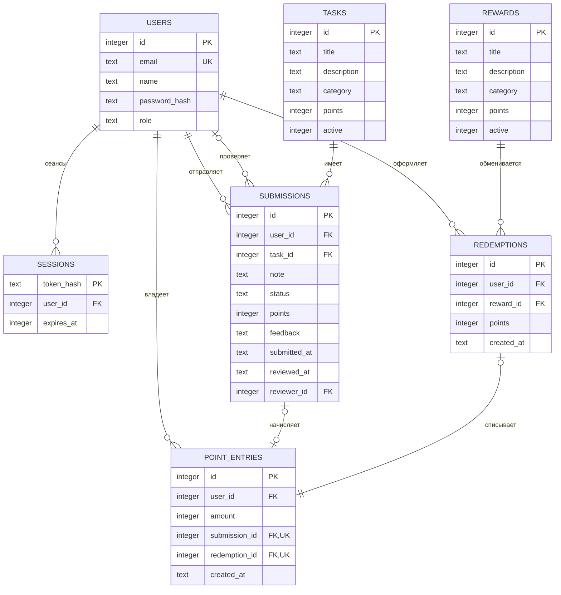

# Концепция и архитектура

## Цель и аудитория

«Командный ход» даёт сотрудникам понятный список активностей, обратную связь по отчётам и прозрачную историю баллов. Для новичков он показывает прогресс по задачам адаптации. Для HR и координаторов он даёт управление каталогами, очередь проверки и способ подтвердить выполнение перед начислением. Гость может просматривать открытые каталоги и создать аккаунт.

Учебная версия основана на корпоративном гиде «Геймификация». Источник сценариев: личный кабинет (стр. 3), биржа задач (стр. 5), рейтинги (стр. 9–10), адаптация (стр. 15–17), награды и администрирование (стр. 18–20). Первая версия реализует задания, начисление, прямой обмен на награду, прогресс и рейтинг. Командные челленджи, корзина, аукционы, Telegram, опросы и Pomodoro относятся к расширению продукта.

## Функции

| Посетитель | Сотрудник | Администратор |
| --- | --- | --- |
| Главная, каталоги и карточки | Отчёты, доработка и статусы | Проверка отчётов, комментарии |
| Поиск, категория, сортировка по баллам | Прогресс адаптации и рейтинг по двум метрикам | Создание и обновление заданий и наград |
| Регистрация и вход | Кабинет, имя, баланс, обмен и история | Чтение и архивация записей |

## Стек и схема взаимодействия

HTML, CSS и JavaScript ES modules подходят для компактного SPA без сборки. CSS Grid адаптирует страницы для разных ширин. Fetch обращается к JSON API по тому же origin. Node.js обслуживает API и статику одним процессом. SQLite обеспечивает простое развёртывание и транзакции для журнала баллов. Docker Compose закрепляет конфигурацию среды, порт и том.

## ER-диаграмма

| Сущность | Назначение и ограничения |
| --- | --- |
| `users`, `sessions` | Сотрудники и администраторы. Email уникален, сеанс хранит хеш токена и время истечения. |
| `tasks`, `rewards` | Каталожные записи. `active=0` означает архив. История сохраняет внешние ключи. |
| `submissions` | Один текущий отчёт на пару сотрудник–задание. `rejected` разрешает обновить отчёт, а `approved` фиксирует начисление. |
| `redemptions` | Один обмен на пару сотрудник–награда. Стоимость фиксируется в момент обмена. |
| `point_entries` | Журнал с положительной суммой для принятого отчёта или отрицательной для обмена. Ровно один из двух FK заполняется. |

Начисление и перевод отчёта в `approved` входят в одну транзакцию. При обмене в одной транзакции проверяется баланс, создаётся запись обмена и записывается дебет. Ограничения UNIQUE и `BEGIN IMMEDIATE` исключают двойное начисление или списание при повторе и конкуренции. Баланс вычисляется как сумма журнала.

## API и обработка состояний

| Область | Методы и пути |
| --- | --- |
| Сервис | `GET /api/health` |
| Сессия | `POST /api/auth/register`, `POST /api/auth/login`, `POST /api/auth/logout` |
| Каталоги | `GET /api/tasks`, `GET /api/rewards`, `GET /api/tasks/{id}`, `GET /api/rewards/{id}` |
| Сотрудник | `POST /api/tasks/{id}/submit`, `POST /api/rewards/{id}/redeem` |
| Кабинет и рейтинг | `GET /api/me`, `PATCH /api/me`, `GET /api/me/dashboard`, `GET /api/leaderboard` |
| Управление | `GET/POST /api/admin/{tasks,rewards}`, `GET/PUT/DELETE /api/admin/{tasks,rewards}/{id}` |
| Проверка | `GET /api/admin/submissions`, `PATCH /api/admin/submissions/{id}` |

Каталоги принимают `q`, `category` и `sort`. Запросы с телом используют `application/json`. Пароли хешируются scrypt с отдельной солью, токены сеансов передаются в cookie HttpOnly и SameSite=Lax. Административные операции проверяют роль на сервере. Некорректные, конфликтующие и запрещённые запросы возвращают структурированные ошибки. Клиент показывает загрузку, пустой результат, ошибки формы и подтверждение, сохраняет контекст после входа и предотвращает повторные нажатия во время запроса.

Полные форматы запроса и ответа описаны в [OpenAPI](../openapi.json). Примеры фактических ответов приведены в [результатах браузерной проверки](api-run.json).
