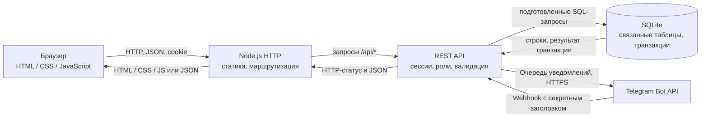
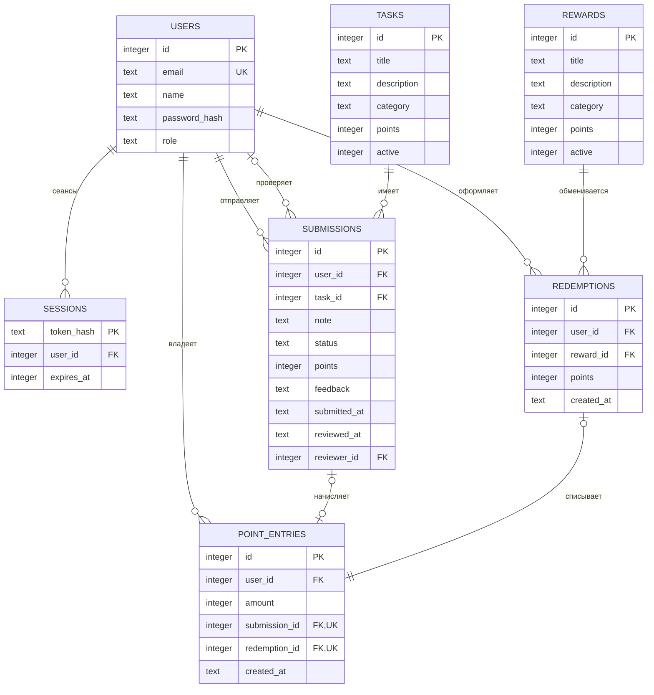

# Концепция и архитектура

## Цель и аудитория

«Командный ход» даёт сотрудникам понятный список активностей, обратную связь по отчётам и прозрачную историю баллов. Для новичков он показывает прогресс по задачам адаптации. Для HR и координаторов он даёт управление каталогами, очередь проверки и способ подтвердить выполнение перед начислением. Гость может просматривать открытые каталоги и создать аккаунт.

Учебная версия основана на сценариях корпоративного гида «Геймификация». Каталоги, отчёты и история баллов связаны с пошаговой адаптацией, челленджами, магазином и игровыми активностями. План прохождения приведён в [README](../README.md).

## Функции

| Посетитель | Сотрудник | Администратор |
| --- | --- | --- |
| Главная, каталоги и карточки | Отчёты, доработка и статусы | Проверка отчётов, комментарии |
| Поиск, категория, сортировка по баллам | Прогресс адаптации и рейтинг по двум метрикам | Создание и обновление заданий и наград |
| Регистрация и вход | Кабинет, имя, баланс, обмен и история | Чтение и архивация записей |
| | Текущие и завершённые челленджи, значки, каталог коллег | Публикация челленджей, назначение отделов |
| | Корзина, заказы, отчёты на кэшбек, лоты и ставки | Выдача заказов, акции, проверка кэшбека, подведение итогов торгов |
| | Колесо фортуны, опросы и квизы, Pomodoro, привязка Telegram | Публикация опросов и просмотр результатов |
| | Категории наград и контактная информация | Управление категориями, профилями и настройками сайта |

## Стек и схема взаимодействия

HTML, CSS и JavaScript ES modules подходят для компактного SPA без сборки. CSS Grid адаптирует страницы для разных ширин. Fetch обращается к JSON API по тому же origin. Node.js обслуживает API и статику одним процессом. SQLite обеспечивает простое развёртывание и транзакции для журнала баллов. Docker Compose закрепляет конфигурацию среды, порт и том.

## ER-диаграмма

| Сущность | Назначение и ограничения |
| --- | --- |
| `users`, `sessions` | Сотрудники и администраторы. Email уникален, сеанс хранит хеш токена и время истечения. |
| `tasks`, `rewards` | Каталожные записи. `active=0` означает архив. История сохраняет внешние ключи. |
| `submissions` | Один текущий отчёт на пару сотрудник–задание. `rejected` разрешает обновить отчёт, а `approved` фиксирует начисление. |
| `redemptions` | Один обмен на пару сотрудник–награда. Стоимость фиксируется в момент обмена. |
| `point_entries` | Журнал с положительной суммой для принятого отчёта или отрицательной для обмена. Ровно один из двух FK заполняется. |

Начисление и перевод отчёта в `approved` входят в одну транзакцию. При покупке сервер проверяет баланс, фиксирует цену и количество в заказе, записывает дебет и очищает корзину. Ограничения UNIQUE и `BEGIN IMMEDIATE` защищают от двойного начисления или списания при повторе и конкуренции. Представление `wallet_entries` объединяет исходный журнал и операции новых модулей. Баланс вычисляется как сумма журнала.

### Связи дополнительных модулей

```mermaid
erDiagram
    USERS ||--o| EMPLOYEE_DETAILS : "описание и отдел"
    USERS ||--o{ EXTENDED_POINTS : "операции"
    USERS ||--o{ CART_ITEMS : "корзина"
    REWARDS ||--o{ CART_ITEMS : "товары"
    REWARDS ||--o| REWARD_MEDIA : "фото"
    STORE_CATEGORIES ||--o{ STORE_REWARD_CATEGORIES : "раздел каталога"
    REWARDS ||--o| STORE_REWARD_CATEGORIES : "дополнительная категория"
    USERS ||--o{ ORDERS : "оформляет"
    ORDERS ||--|{ ORDER_ITEMS : "позиции"
    REWARDS ||--o{ ORDER_ITEMS : "товар"
    REWARDS ||--o{ CASHBACK_CAMPAIGNS : "акции"
    TASKS ||--o{ CASHBACK_CAMPAIGNS : "условие"
    CASHBACK_CAMPAIGNS ||--o{ CASHBACK_OFFERS : "снимок акции"
    ORDERS ||--o{ CASHBACK_OFFERS : "доступный возврат"
    ORDERS ||--o{ CASHBACK_REPORTS : "отчёты"
    CASHBACK_CAMPAIGNS ||--o{ CASHBACK_REPORTS : "проверяет"
    ORDERS ||--o{ CASHBACK_CLAIMS : "начисление"
    CASHBACK_CAMPAIGNS ||--o{ CASHBACK_CLAIMS : "применяется"
    USERS ||--o{ CASHBACK_CLAIMS : "получает"
    USERS ||--o{ WHEEL_SPINS : "попытки"
    USERS ||--o{ CHALLENGE_MEMBERS : "участие"
    CHALLENGES ||--o{ CHALLENGE_MEMBERS : "участники"
    CHALLENGES ||--|{ CHALLENGE_TASKS : "условия"
    TASKS ||--o{ CHALLENGE_TASKS : "задания"
    POLLS ||--|{ POLL_OPTIONS : "варианты"
    POLLS ||--o{ POLL_VOTES : "голоса"
    POLL_OPTIONS ||--o{ POLL_VOTES : "выбран"
    USERS ||--o{ POLL_VOTES : "голосует"
    REWARDS ||--o{ AUCTIONS : "лот"
    AUCTIONS ||--o{ AUCTION_BIDS : "ставки"
    USERS ||--o{ AUCTION_BIDS : "ставит"
    USERS ||--o{ POMODORO_SESSIONS : "интервалы"
    USERS ||--o| TELEGRAM_LINKS : "привязывает"
    USERS ||--o{ NOTIFICATION_OUTBOX : "уведомления"
```

| Сущности | Правила |
| --- | --- |
| `cart_items`, `orders`, `order_items` | У сотрудника одна строка на товар в корзине. Заказ фиксирует позиции и стоимость. |
| `cashback_*` | Акция закрепляется при покупке. Отчёт, решение администратора и начисление относятся к паре заказ–акция. |
| `challenges`, `challenge_tasks`, `challenge_members` | Отдел фиксируется при вступлении. Прогресс учитывает принятые отчёты по условиям челленджа, награда имеет одно начисление на участника. |
| `wheel_spins`, `poll_votes` | Сервер проверяет недельный интервал колеса и один голос на опрос. |
| `auctions`, `auction_bids` | Баллы лидера резервируются, перебитая ставка возвращается в той же транзакции. |
| `pomodoro_sessions` | Идентификатор отрезка обеспечивает идемпотентную запись статистики. |
| `telegram_links`, `notification_outbox` | Одноразовый код хранится в виде хеша. Неотправленные уведомления остаются в очереди с отложенными повторами. |
| `store_categories`, `store_reward_categories` | Дополнительные категории назначаются без изменения исходных записей. Архивация категории требует предварительно перенести или архивировать её активные товары. |
| `site_settings` | Одна запись хранит название, SEO-описание, контакты, тему админки и PNG логотипа. |

## API и обработка состояний

| Область | Методы и пути |
| --- | --- |
| Сервис | `GET /api/health` |
| Сессия | `POST /api/auth/register`, `POST /api/auth/login`, `POST /api/auth/logout` |
| Каталоги | `GET /api/tasks`, `GET /api/rewards`, `GET /api/tasks/{id}`, `GET /api/rewards/{id}` |
| Сотрудник | `POST /api/tasks/{id}/submit`, `POST /api/rewards/{id}/redeem` |
| Кабинет и рейтинг | `GET /api/me`, `PATCH /api/me`, `GET /api/me/dashboard`, `GET /api/leaderboard` |
| Управление | `GET/POST /api/admin/{tasks,rewards}`, `GET/PUT/DELETE /api/admin/{tasks,rewards}/{id}` |
| Проверка | `GET /api/admin/submissions`, `PATCH /api/admin/submissions/{id}` |
| Магазин | `GET /api/cart`, `PUT /api/cart/{id}`, `POST /api/cart/checkout`, `GET /api/orders` |
| Квест и справочник | `GET /api/onboarding`, `POST /api/onboarding/{id}/submit`, `GET /api/employees[/{id}]` |
| Челленджи | `GET /api/challenges[/{id}]`, `POST /api/challenges/{id}/join`, `POST /api/challenges/{id}/claim` |
| Активности | `GET /api/wheel`, `POST /api/wheel/spin`, `GET/POST /api/pomodoro`, `GET /api/polls`, `POST /api/polls/{id}/vote` |
| Аукционы и кэшбек | `GET /api/auctions[/{id}]`, `POST /api/auctions/{id}/bid`, `GET /api/cashback`, `POST /api/cashback/{id}/{submit,claim}` |
| Telegram | `GET /api/telegram`, `POST /api/telegram/link`, `POST /api/telegram/webhook` |
| Настройки сайта и категории | `GET /api/settings`, `PUT /api/admin/settings`, `PUT/DELETE /api/admin/settings/logo`, `GET /api/reward-categories`, `GET/POST /api/admin/reward-categories`, `PATCH /api/admin/reward-categories/{code}` |

Каталоги принимают `q`, `category` и `sort`. Запросы с телом используют `application/json`. Пароли хешируются scrypt с отдельной солью, токены сеансов передаются в cookie HttpOnly и SameSite=Lax. Административные операции проверяют роль на сервере. Некорректные, конфликтующие и запрещённые запросы возвращают структурированные ошибки. Клиент показывает загрузку, пустой результат, ошибки формы и подтверждение, сохраняет контекст после входа и предотвращает повторные нажатия во время запроса.

Форматы запросов и ответов, включая административные операции новых разделов, описаны в [OpenAPI](../openapi.json). Доступны примеры фактических ответов [первой версии](api-run.json) и [дополнительных модулей](expanded-api-run.json).
